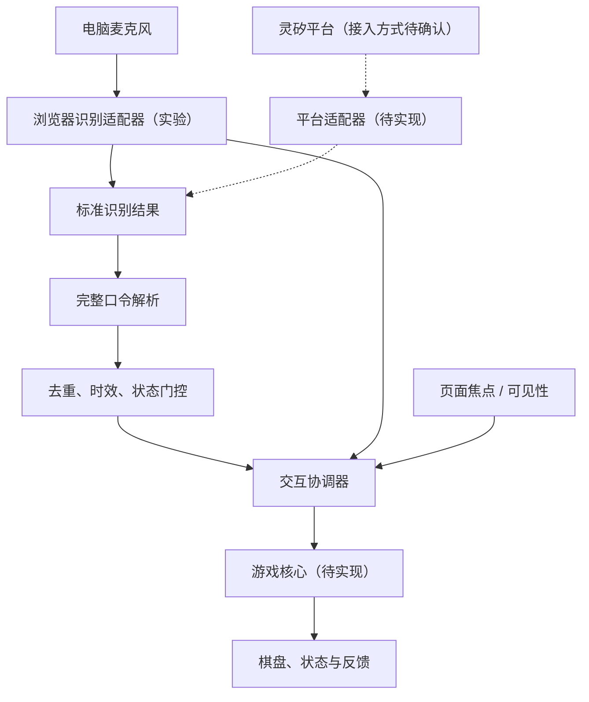
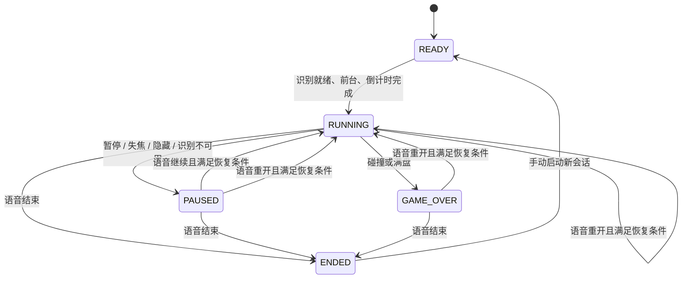
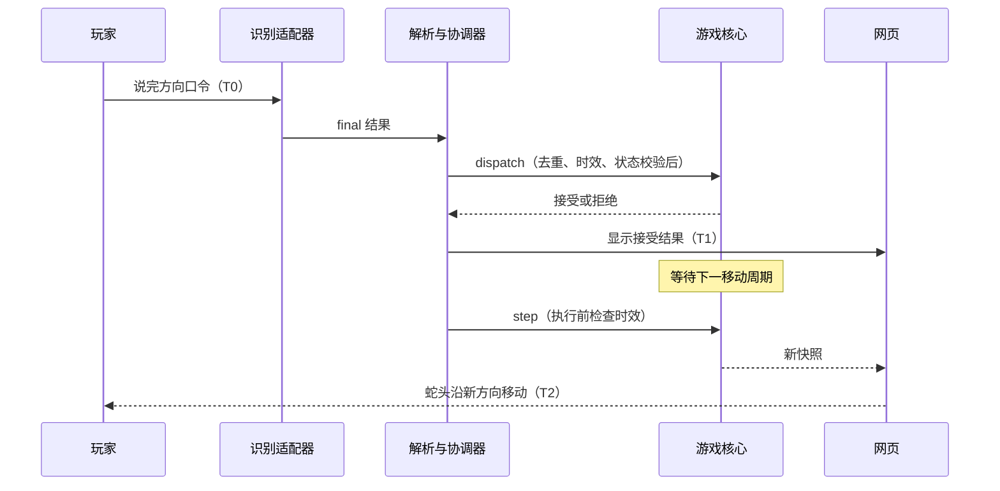

# 架构设计

更新日期：2026-10-23。本文区分已实现模块与目标接口；Mermaid 图源可直接编辑，并在支持 Mermaid 的 Markdown 阅读器中渲染。

## 系统边界

网页运行游戏核心、展示棋盘并处理交互状态。识别适配器提供标准文本结果，游戏逻辑不依赖特定语音厂商。灵矽平台的接入接口、鉴权和演示入口待确认，图中虚线为待确认输入路径，不表示已有平台 SDK。



当前验证页用模拟状态与方向指示替代游戏核心及棋盘，尚无可运行的蛇移动链路。

## 模块规格与分工

| 模块 | 输入与输出 | 职责 | 状态 | 负责人 |
| --- | --- | --- | --- | --- |
| 识别适配器 | 麦克风 → VoiceInput、状态、错误 | 识别会话、回调、停止及启动超时 | 浏览器实验已实现，麦克风待测 | 朱晶 |
| 指令解析 | 文本 → Command/null | 完整匹配、别名、空白和句末标点处理 | 已实现 | 朱晶 |
| 指令门控 | CommandEvent、状态、时钟 → Receipt | 去重、输入时效和状态合法性 | 已实现；执行前复检待集成 | 朱晶 |
| 交互协调器 | 识别/焦点事件 → 游戏调用、反馈 | 启动条件、异常暂停、恢复前置条件 | 验证页部分实现，完整协调待实现 | 朱晶 |
| 游戏核心 | 命令、tick、随机源 → GameSnapshot | 移动、碰撞、增长、计分和结算 | 待实现 | 朱晶 |
| 网页与反馈 | 快照、识别状态 → 画面与音效 | 棋盘、分数、接受/执行结果 | 验证页已实现，游戏页面待实现 | 朱晶 |
| 验证材料 | 测试样本、实机结果 → 测试报告 | 用例、环境矩阵、结果与演示素材 | 用例初版，实测待补充 | 王任 |

## 已实现的输入契约

以下为现有 JavaScript 模块的类型化说明，非独立 TypeScript 源文件。

```ts
type Direction = 'UP' | 'DOWN' | 'LEFT' | 'RIGHT';
type Command = Direction | 'PAUSE' | 'RESUME' | 'RESTART' | 'END';
type GameState = 'READY' | 'RUNNING' | 'PAUSED' | 'GAME_OVER' | 'ENDED';
type VoiceInput = {
  text: string;
  resultId: string;   // 识别会话前缀 + 结果索引
  receivedAt: number; // performance.now()，表示回调到达时间
  isFinal: boolean;
};
type CommandEvent = { command: Command; id: string; receivedAt: number };
type Receipt = { accepted: boolean; reason: string };
```

`src/commands.mjs` 提供 `parseCommand(text)` 和 `createCommandGate({ttlMs, capacity})`；门控的 `accept(event, state, now)` 返回 Receipt。默认 TTL 为 1500ms，去重记录上限 256 条。

`src/browser-voice.mjs` 提供 `BrowserVoice`，通过 `start()`、`stop()` 管理识别，回调为 `onStatus`、`onText`、`onFailure`。首版只执行 final 结果，中间结果仅展示。启动等待上限 15 秒；意外结束后停止，由界面发起恢复，不自动循环重试。

去重以结果 ID 为单位，缓存超过上限后淘汰旧记录，不提供无限期去重。TTL 只衡量回调到达后的时间，不包含语音服务内部耗时。

## 游戏核心接口（设计，待实现）

游戏核心不直接访问 DOM、麦克风或浏览器计时器，调度与识别就绪检查由协调器负责。

```ts
type Point = { x: number; y: number };
type GameResult = {
  outcome: 'WIN' | 'LOSS' | 'ABORTED';
  reason: 'board_full' | 'wall' | 'self' | 'manual_end';
} | null;
type GameSnapshot = {
  roundId: number;
  state: GameState;
  cols: number;
  rows: number;
  snake: Point[];             // 蛇头在前
  direction: Direction;
  pendingDirection: Direction | null;
  food: Point | null;         // 满盘时为 null
  score: number;
  tick: number;
  result: GameResult;
};
interface GameEngine {
  start(): GameSnapshot;
  dispatch(event: CommandEvent, now: number): Receipt;
  step(now: number): GameSnapshot;
  pause(reason: 'focus' | 'hidden' | 'voice_unavailable'): GameSnapshot;
  snapshot(): GameSnapshot;
}
```

引擎构造时注入棋盘配置和随机源。`start()` 仅用于 READY/ENDED 的新会话；RESTART 通过 `dispatch` 创建新一局，清空分数、结果和待执行方向，增加 roundId。`snapshot()` 返回只读副本。`step()` 仅在 RUNNING 前进一步，其他状态不移动，也不累计补走步数。

状态命令即时生效；方向在 dispatch 时检查反向及当前周期容量，合法方向进入 pendingDirection，下次 step 再执行。accepted 表示已接收，不等于已在画面转向。同向口令返回接受且不占用转向容量；第二个不同方向返回 `turn_pending`，反向返回 `opposite_direction`。

协调器只在命令入口做结果 ID 去重；执行 step 前单独检查待转向时效及所属轮次，不再次调用去重门控。过期转向丢弃并反馈，继续沿原方向移动。暂停、重开、失焦、识别断开及结算均清空待执行转向；当前识别会话的去重记录跨局保留。

移动碰撞以更新后的占用情况计算：未吃食物时尾格本步会腾空，可进入旧尾格；吃到食物时保留尾格。食物仅从空格中生成，满盘直接 WIN。碰撞为 LOSS；主动结束未结算的一局为 ABORTED，结算后结束会话保留已有胜负结果。

## 状态转换（设计）



恢复条件为识别监听已就绪、页面可见且有焦点。焦点或连接恢复本身不改变 PAUSED。权限故障需要手动恢复时，本次流程归类为异常恢复。READY 倒计时被失焦、隐藏或识别中断取消，恢复后重新满足启动条件才重新计时。

## 转向时序与延迟（设计）



指令确认延迟为 T1−T0，实际转向延迟为 T2−T0。暂停等状态命令即时处理，不等待移动周期。

初始 500ms/格方案的参考预算如下，均为设计预算而非实测：

| 环节 | 参考预算 |
| --- | --- |
| 语音结束到 final 结果 | 200ms |
| 解析、门控和派发 | 20ms |
| 等待移动周期 | 0–500ms；若到达相位均匀，期望约 250ms |
| 画面更新 | 30ms |

预算说明典型转向延迟可能接近 500ms，不保证每次达标；分项中位数也不能直接相加作为端到端实测中位数。最终以录屏中 T0/T1/T2 统计为准。超出目标时优先降低识别等待或下一周期等待；放慢蛇速能增加操作容错，但会增加周期等待，不能作为降低转向延迟的手段。速度或执行策略调整后重新验收。

## 识别与部署

当前实验使用浏览器 SpeechRecognition/webkitSpeechRecognition，语言 zh-CN。最终方案依据四个目标环境的可用性、正确率和延迟确定；若实验服务不满足要求，再评估比赛开放能力或获授权流式 ASR。

当前为原生 ES 模块，无构建依赖。静态开发服务仅监听回环地址；正式外部部署使用 HTTPS。需保密凭证的识别服务由后端或短期凭证接入。网页不持久化语音和诊断日志；测试证据按测试报告中的授权与脱敏要求保存。
